# Manual Técnico — Sistema de Reservas EIC

Sistema de registro de acceso a laboratorios y reserva de espacios de la Escuela de Ingeniería Civil (EIC), Universidad de Costa Rica.

Este documento describe la arquitectura, el modelo de datos, los módulos funcionales y el despliegue del sistema `registro`, para referencia de quien le dé mantenimiento o continúe su desarrollo.

---

## 1. Visión general

El sistema tiene tres tipos de usuario, cada uno con su propio flujo de autenticación y funcionalidades:

| Rol | Autenticación | Funciones principales |
|---|---|---|
| **Estudiante** | Active Directory | Registrar su ingreso a un laboratorio |
| **Docente** | Active Directory | Registrar ingreso, reservar espacios, ver calendario |
| **Administrativo** | Active Directory | Ver registros de acceso, crear reservas, ver calendario, gestionar catálogo de cursos/espacios |

Todas las reservas y registros de acceso quedan centralizados en una sola base de datos (`sistema_reservas_eic`), consultada por los tres módulos.

### 1.1 Pantalla de acceso

Al entrar al sistema, la persona elige su rol. Los administrativos ingresan por una ruta separada (`/administrativo`), no visible desde la pantalla principal, para no exponerla a estudiantes/docentes.

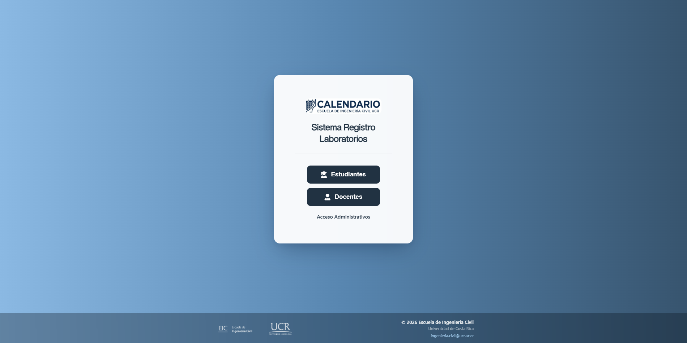

Cada rol tiene su propia pantalla de inicio de sesión, visualmente distinguible por el color/etiqueta del rol:

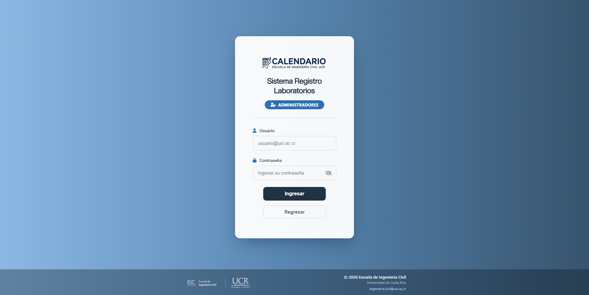
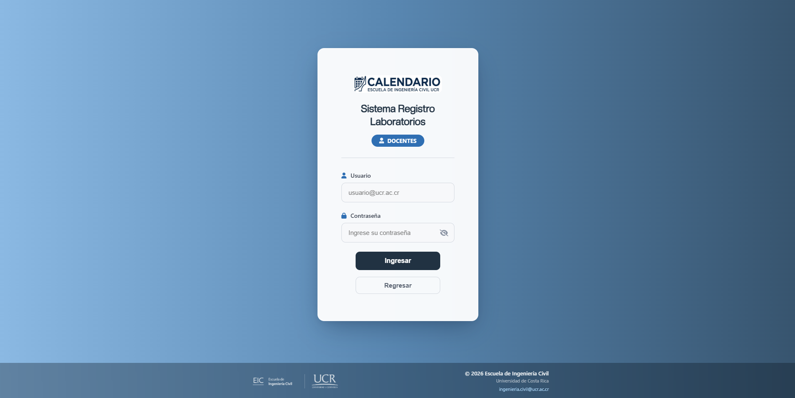


---

## 2. Arquitectura y stack tecnológico

- **Backend**: PHP 8.3 (sin framework, scripts procedurales por página).
- **Base de datos**: MariaDB 11.
- **Autenticación**: LDAP simple bind contra Active Directory (`AD_SERVER`), puerto 389, sin TLS. Cada usuario se autentica con su propia cuenta de dominio — **no existe ninguna cuenta de servicio**; el sistema no necesita privilegios especiales en el AD, solo poder alcanzar el DC por red.
- **Servidor web**: nginx + PHP-FPM dentro de un mismo contenedor Docker, administrados por `supervisord` (sin Apache).
- **Frontend**: HTML/CSS/JS vanilla + jQuery, Bootstrap 5 (solo para componentes puntuales como modales), FullCalendar (calendarios), Flatpickr (selector de fecha), Alertify.js (diálogos de confirmación), SheetJS y pdfmake (exportar tablas a Excel/PDF).
- **Contenerización**: Docker Compose, dos servicios (`web`, `db`), red interna privada; la base de datos no publica ningún puerto al host.
- **Correo**: deshabilitado permanentemente a propósito (funciones no-op en `shared/utils/send-mail.php`) — el sistema **nunca** envía correos, bajo ningún flujo.

### 2.1 Diagrama de componentes (despliegue objetivo)

```
Internet → Apache (VM compartida, reverse proxy, termina TLS)
              │
              └── VirtualHost del subdominio del sistema
                     ProxyPass → 127.0.0.1:8083
                            │
                            ▼
                 Contenedor Docker "web"
                 ┌─────────────────────────┐
                 │ nginx (puerto 80)       │
                 │   └─ PHP-FPM            │
                 └───────────┬─────────────┘
                              │ red interna (registro_net)
                              ▼
                 Contenedor Docker "db"
                 MariaDB 11 (sin puerto público)

        El contenedor "web" también sale por red hacia:
        → Active Directory (serverlic.eic.ucr.ac.cr:389)
```

---

## 3. Estructura del proyecto

```
registro/
├── administrativo/          Páginas del módulo administrativo
├── docente/                 Páginas del módulo docente
├── estudiante/               Páginas del módulo estudiante
├── shared/
│   ├── css/                  Hojas de estilo (una por "familia" de pantalla)
│   ├── img/                  Imágenes usadas por la app en vivo (logos, íconos)
│   ├── fonts/                 Tipografía institucional (CreatoDisplay)
│   ├── csv/                  CSV de carga inicial de cursos
│   ├── lib/                  Librerías de terceros (Bootstrap, jQuery, FullCalendar, etc.)
│   ├── utils/                 Lógica compartida (conexión a BD, AD, envío de correo no-op, etc.)
│   ├── iniciar-sesion-adds.php   Login real (LDAP) — usado por los 3 roles
│   └── cerrar-sesion.php
├── docker/                   Configuración de nginx, PHP y supervisord para el contenedor
├── img/                      Capturas de referencia para este manual (no se despliega)
├── doc/                      Documentación adicional (no se despliega)
├── Dockerfile
├── compose.yaml
├── .env.example               Plantilla de variables de entorno
├── index.php / inicio.php     Redirección raíz / selección de rol
└── README.md
```

> **Nota:** `img/`, `doc/`, `.env`, `notes.txt` y `.git/` quedan explícitamente fuera de la imagen Docker (ver `Dockerfile`, bloque de `COPY`) — nunca se sirven en producción.

---

## 4. Modelo de datos

Base de datos: `sistema_reservas_eic`. Todas las tablas usan `InnoDB` / `utf8mb4`.

### 4.1 Tablas activas

| Tabla | Propósito | Columnas clave |
|---|---|---|
| **`lista_horarios`** | Toda reserva de espacio (el corazón del sistema) | `id` (PK), `espacio`, `sigla_curso`, `nombre_curso`, `solicitante`, `correo`, `hora_inicio`, `hora_fin`, `estado` (`aprobado`/`rechazado`), `serie_id` (agrupa reservas repetidas) |
| **`registro_docente`** | Bitácora de entrada/retiro de cartuchera de docentes | `id` (PK), `nombre`, `correo`, `cedula`, `celular`, `sigla_curso`, `espacio`, `fecha_ingreso` |
| **`registro_estudiante`** | Bitácora de entrada/retiro de cartuchera de estudiantes | `id` (PK), `nombre`, `correo`, `carnet`, `celular`, `laboratorio`, `fecha_ingreso` |
| **`cursos`** | Catálogo de cursos (autocompletado en los formularios de reserva) | `sigla_curso` (PK), `nombre_curso` |
| **`espacios`** | Catálogo de salas/laboratorios reservables (alimenta las pestañas del calendario y el selector de espacio) | `nombre` (PK) |

Ambos catálogos (`cursos`, `espacios`) se administran desde **Gestión de cursos y salas** (solo administrativo) — ver sección 5.3.4.

### 4.2 Tablas obsoletas (no las usa ningún código en producción)

| Tabla | Motivo |
|---|---|
| `usuarios_administrativos` | Credenciales locales de un sistema de login anterior al AD |
| `usuarios_docentes` | ídem |
| `usuarios_estudiantes` | ídem |

Se mantienen en el esquema por compatibilidad con dumps antiguos, pero ningún endpoint las consulta — el login siempre pasa por LDAP/AD.

---

## 5. Módulos funcionales

### 5.1 Módulo Estudiante

Un solo propósito: registrar el ingreso a un laboratorio.

- **Login** (AD) → redirige directo al formulario de registro (no hay pantalla de inicio intermedia).
- **Formulario de registro**: nombre y correo institucional se traen de la sesión de AD (no editables); el estudiante completa carnet, celular y confirma el laboratorio (actualmente solo "Laboratorio 1"). La fecha/hora de ingreso se registra automáticamente al enviar (campo oculto, no se le pide a la persona).
- Al enviar, el registro queda en `registro_estudiante`.

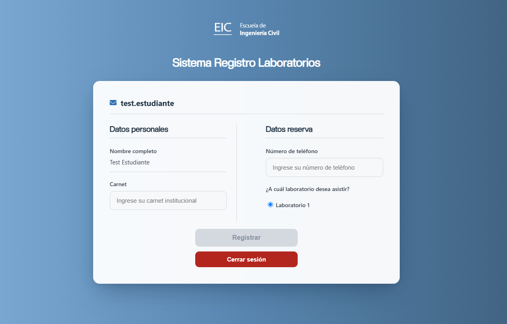

### 5.2 Módulo Docente

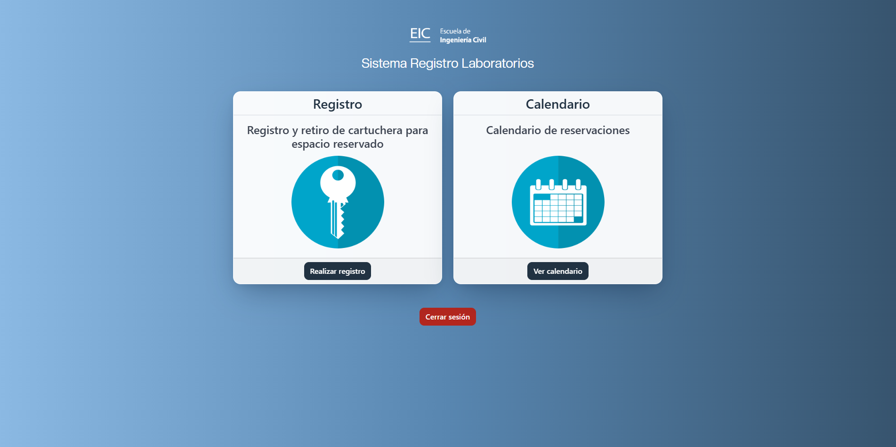

Dos funciones desde la pantalla de inicio:

#### 5.2.1 Registro (ingreso a laboratorio)

Formulario con **Datos personales** (nombre/correo de la sesión de AD, cédula, celular) y **Datos de reservación** (sigla y nombre del curso —autocompletado contra el catálogo `cursos`—, y el espacio a utilizar, cargado dinámicamente desde el catálogo `espacios`).

Los campos obligatorios se marcan en rojo si se intenta enviar el formulario incompleto:

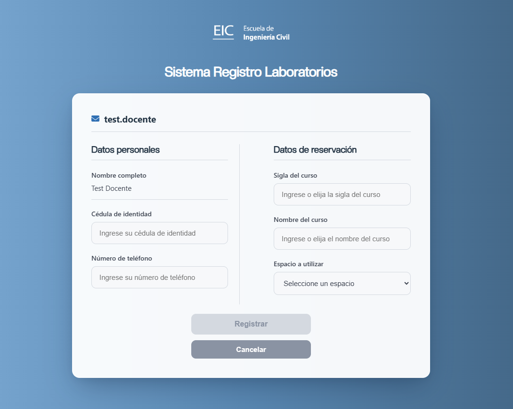
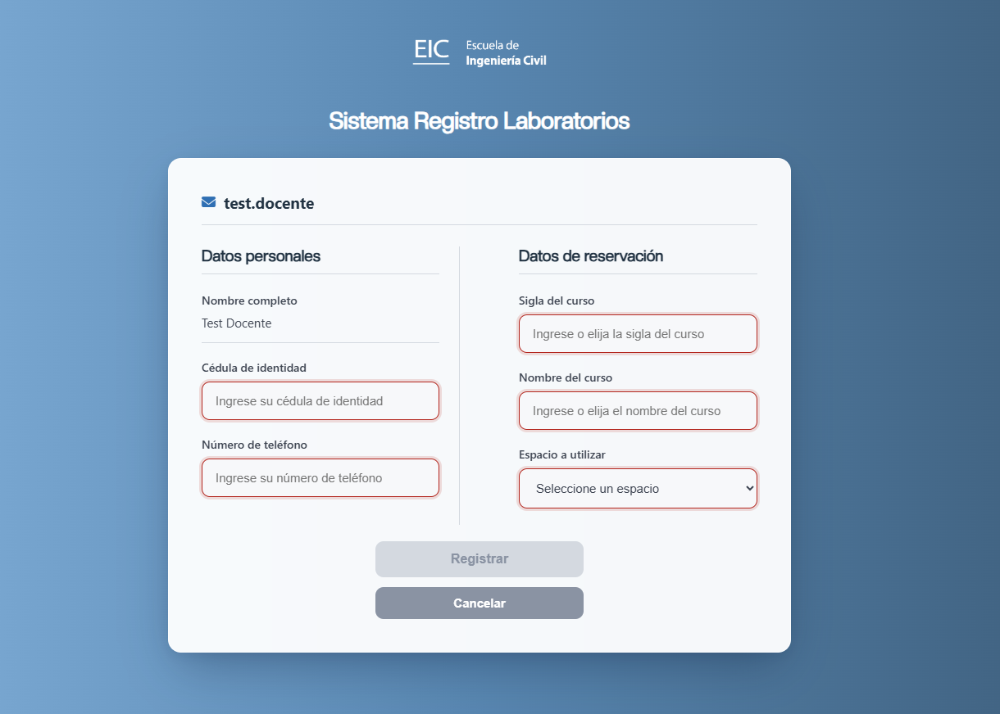

Al enviar, la reserva se crea en `lista_horarios` con `estado = 'aprobado'` de inmediato (no existe flujo de aprobación manual — se descartó esa funcionalidad intencionalmente).

#### 5.2.2 Calendario

Vista de solo lectura de las reservas **aprobadas** de todos los espacios, organizada en pestañas (una por espacio del catálogo, laboratorios primero). Los docentes ven el espacio y horario reservado, pero no el detalle de quién reservó ni el motivo (a diferencia de administrativo).

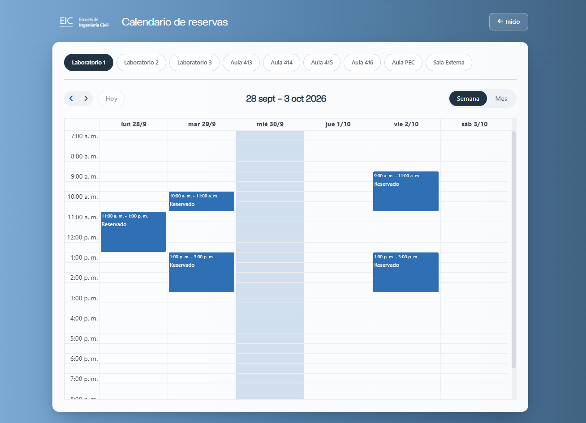

### 5.3 Módulo Administrativo

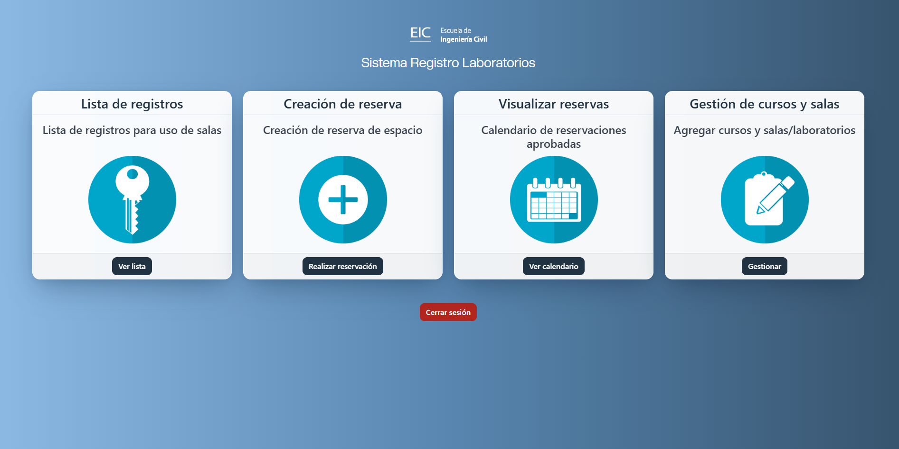

Cuatro funciones:

#### 5.3.1 Lista de registros

Tablas de bitácora de acceso (`registro_estudiante` / `registro_docente`) con búsqueda y exportación a Excel/PDF.

**Limpieza automática**: cada vez que se abre esta pantalla, se eliminan de esas dos tablas los registros anteriores al mes actual y los 2 meses previos (3 meses de ventana por calendario). Esto evita que la bitácora de acceso crezca indefinidamente; no aplica a `lista_horarios` (las reservas no se purgan).

#### 5.3.2 Creación de reserva

A diferencia de docente/estudiante, el administrativo llena los datos de otra persona (no hay sesión de esa persona de la cual tomarlos): nombre y correo del solicitante se escriben manualmente. Permite además:

- Reservar en nombre de cualquier curso, o escribir `NA` y un motivo libre en "Nombre del curso" si la reserva no es para impartir un curso.
- **Repetir la reserva**: elegir un día de la semana y un rango de fechas — crea una reserva por cada ocurrencia de ese día dentro del rango, todas agrupadas bajo un mismo `serie_id`.
- Antes de guardar, se muestra un recuadro de confirmación con el resumen de la reserva.

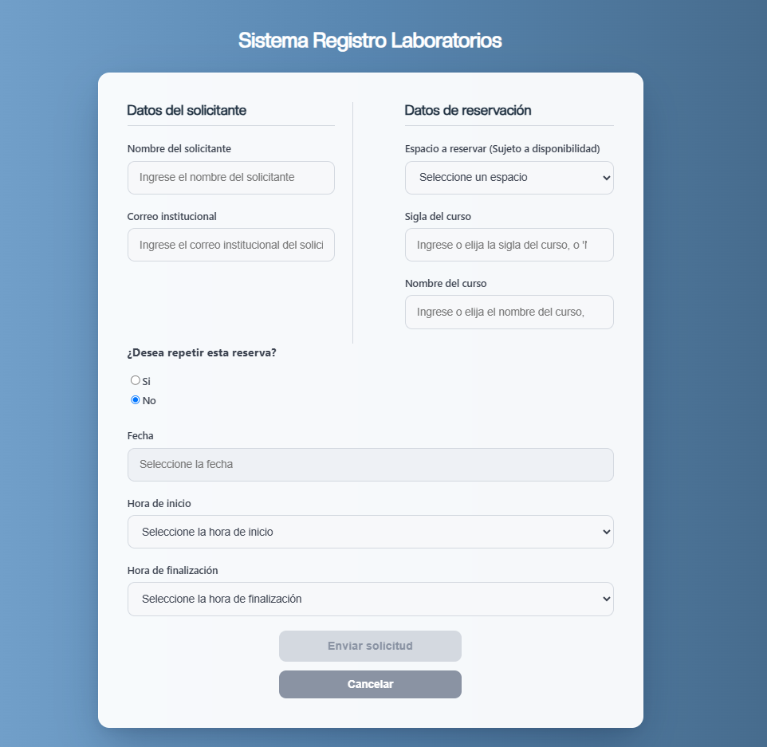

#### 5.3.3 Visualizar reservas (calendario)

Igual que el calendario de docente, pero con el detalle completo de cada reserva (solicitante, correo, curso/motivo) al hacer clic en un evento. Permite cancelar una reserva individual, o **toda una serie repetida de una sola vez** (identificada por `serie_id`).

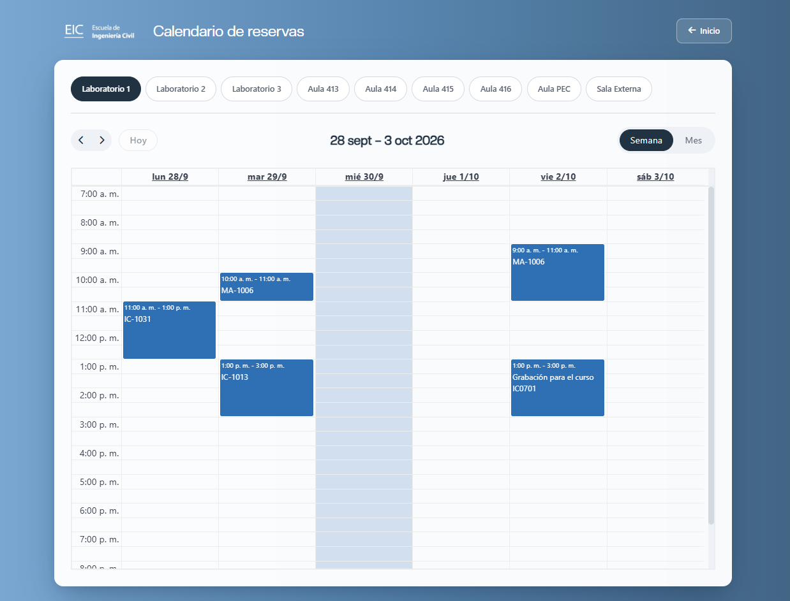

#### 5.3.4 Gestión de cursos y salas

Administra los catálogos `cursos` y `espacios` que alimentan los formularios y el calendario en los tres módulos (los cambios aquí se reflejan de inmediato en docente/administrativo).

- Agregar curso (sigla + nombre) o espacio (nombre), con validación de duplicados.
- Eliminar un curso/espacio — **bloqueado** si todavía tiene reservas aprobadas o pendientes vigentes (`hora_fin >= NOW()`), para no dejar reservas "huérfanas" sin catálogo.
- Buscador en cada lista.

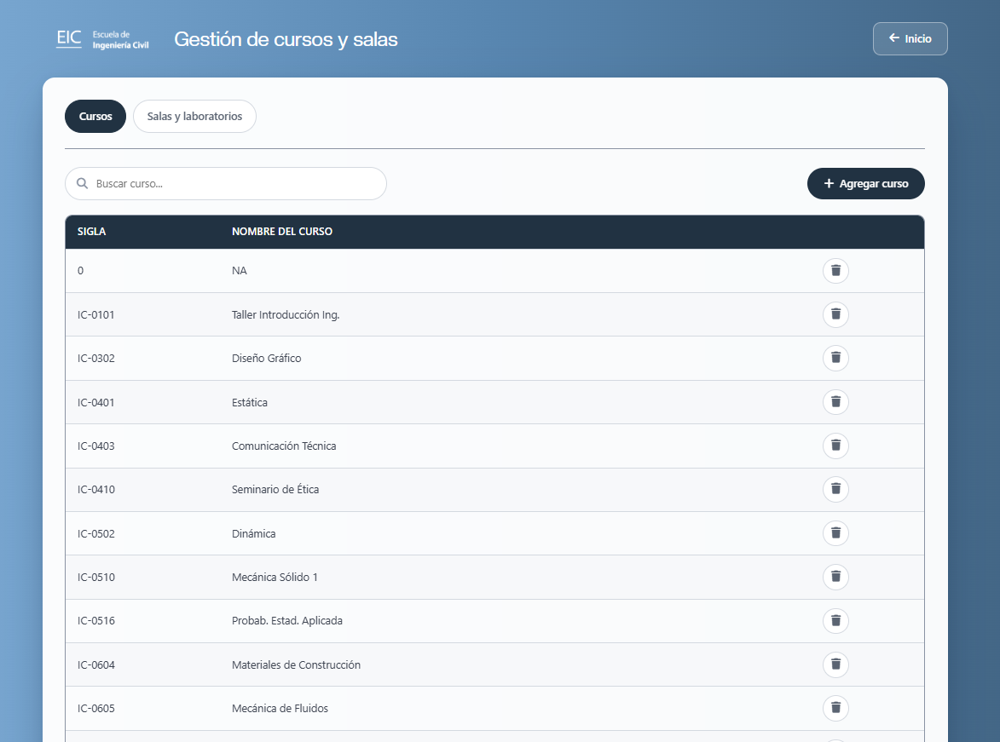

---

## 6. Autenticación (Active Directory)

Archivo: `shared/iniciar-sesion-adds.php`.

1. El usuario ingresa `nombre.apellido@ucr.ac.cr` y su contraseña de dominio. El campo de usuario se normaliza automáticamente a mayúsculas antes del `@` (las cuentas del AD son *capital sensitive*, formato `NOMBRE.APELLIDO@ucr.ac.cr`).
2. Se hace `ldap_bind()` directo con esas credenciales (autenticación como el propio usuario, sin cuenta intermedia).
3. Si el bind es exitoso, se busca el registro del usuario (`ldap_search` por `userprincipalname`) dentro de la OU correspondiente al rol elegido (`LaboratoriosEIC`, `ProfesoresEIC` o `AdministrativosEIC`) — esto valida que la persona pertenece al rol que seleccionó, no solo que tiene una cuenta válida en el dominio.
4. Se guarda `usuario`, `nombre` (atributo `cn`) y `tipo` en la sesión PHP, y se redirige al módulo correspondiente.
5. Intentos fallidos se cuentan por sesión (`$_SESSION['intentos_' . $tipo]`) y se muestran en el mensaje de error.

No hay opción de "recuperar contraseña" ni cambio de contraseña dentro del sistema — la contraseña de dominio se administra desde el propio AD.

---

## 7. Despliegue

### 7.1 Variables de entorno

Copiar `.env.example` a `.env` y completar:

```env
AD_SERVER=serverlic.eic.ucr.ac.cr   # host del AD (LDAP simple, puerto 389)
DB_HOST=db
DB_NAME=sistema_reservas_eic
DB_USER=registro
DB_PASSWORD=
DB_ROOT_PASSWORD=
```

`.env` nunca se commitea (`.gitignore`) ni se hornea en la imagen (`.dockerignore`).

### 7.2 Levantar el entorno

```bash
docker compose build web
docker compose up -d
```

- El contenedor `web` publica el puerto `8083` del host (ajustar en `compose.yaml` si el servidor de destino ya usa ese puerto).
- El contenedor `db` **no** publica ningún puerto al host — solo es alcanzable desde `web` por la red interna `registro_net`.
- En un volumen de base de datos nuevo/vacío, `db-script.sql` crea el esquema automáticamente al primer arranque. En un despliegue real, ese paso se reemplaza por la restauración de un respaldo (`mysqldump`) de los datos de producción.

### 7.3 Producción: reverse proxy

El contenedor no termina TLS ni atiende el hostname público directamente. En producción, un Apache (u otro reverse proxy) ya existente en la VM de destino recibe el tráfico HTTPS y lo reenvía al puerto interno del contenedor:

```apache
<VirtualHost *:443>
    ServerName <subdominio-del-sistema>
    ProxyPreserveHost On
    ProxyPass / http://127.0.0.1:8083/
    ProxyPassReverse / http://127.0.0.1:8083/
    # + certificado TLS del subdominio
</VirtualHost>
```

El `nginx.conf` del contenedor fuerza `HTTPS=on` hacia PHP (vía el header `X-Forwarded-Proto` que debe enviar ese proxy), para que la app genere enlaces `https://` correctamente aunque internamente hable HTTP plano por loopback.

---

## 8. Seguridad — consideraciones conocidas

- **Sin cuenta de servicio de AD**: el sistema nunca necesita, ni debe tener, credenciales de una cuenta administrativa del dominio. Cualquier variable de ese tipo en el código es un resabio y debe eliminarse.
- **Consultas SQL**: la mayoría del código usa concatenación directa de variables en las consultas (patrón heredado, no parametrizado); el código agregado más recientemente (gestión de catálogos) sí usa sentencias preparadas. Es un área de mejora pendiente si se retoma el mantenimiento del sistema.
- **Sin envío de correo**: deshabilitado a propósito y de forma permanente; no reactivar sin una decisión explícita, dado el historial de incidentes que motivó desactivarlo.
- **`.env`, `notes.txt`, `doc/`**: nunca deben terminar en el repositorio público ni en la imagen Docker — verificar `.gitignore`/`.dockerignore` si se agregan nuevos archivos sensibles.

---

## 9. Anexo — índice de capturas (`img/`)

| Archivo | Contenido |
|---|---|
| `01-login-seleccion-rol.png` | Pantalla principal, selección de rol |
| `02-login-administrativo.png` | Login — administrativo |
| `03-login-docente.png` | Login — docente |
| `04-login-estudiante.png` | Login — estudiante |
| `05-inicio-administrativo.png` | Panel de inicio — administrativo |
| `06-inicio-docente.png` | Panel de inicio — docente |
| `07-formulario-registro-estudiante.png` | Formulario de registro — estudiante |
| `08-formulario-registro-docente.png` | Formulario de registro — docente |
| `09-formulario-registro-docente-validacion.png` | Formulario de registro — docente, con validación de campos |
| `10-formulario-crear-reserva-administrativo.png` | Formulario de creación de reserva — administrativo |
| `11-calendario-administrativo.png` | Calendario de reservas — administrativo |
| `12-calendario-docente.png` | Calendario de reservas — docente |
| `13-gestion-cursos-salas-administrativo.png` | Gestión de cursos y salas — administrativo |
