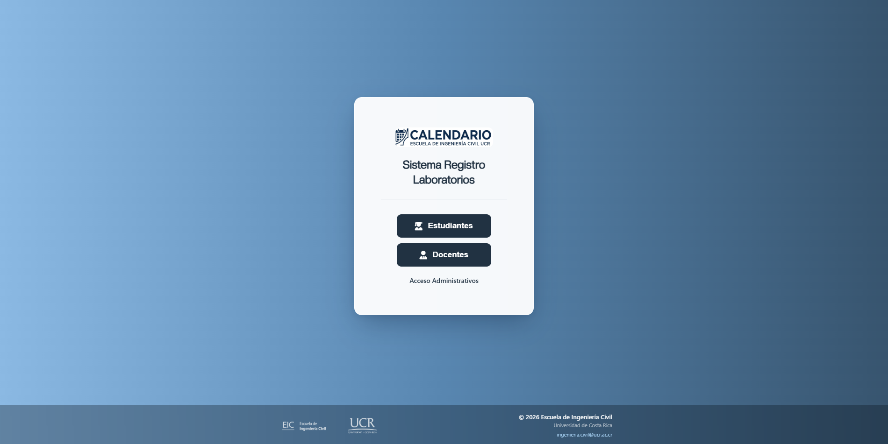
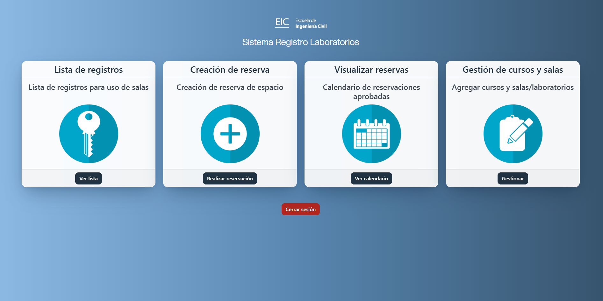
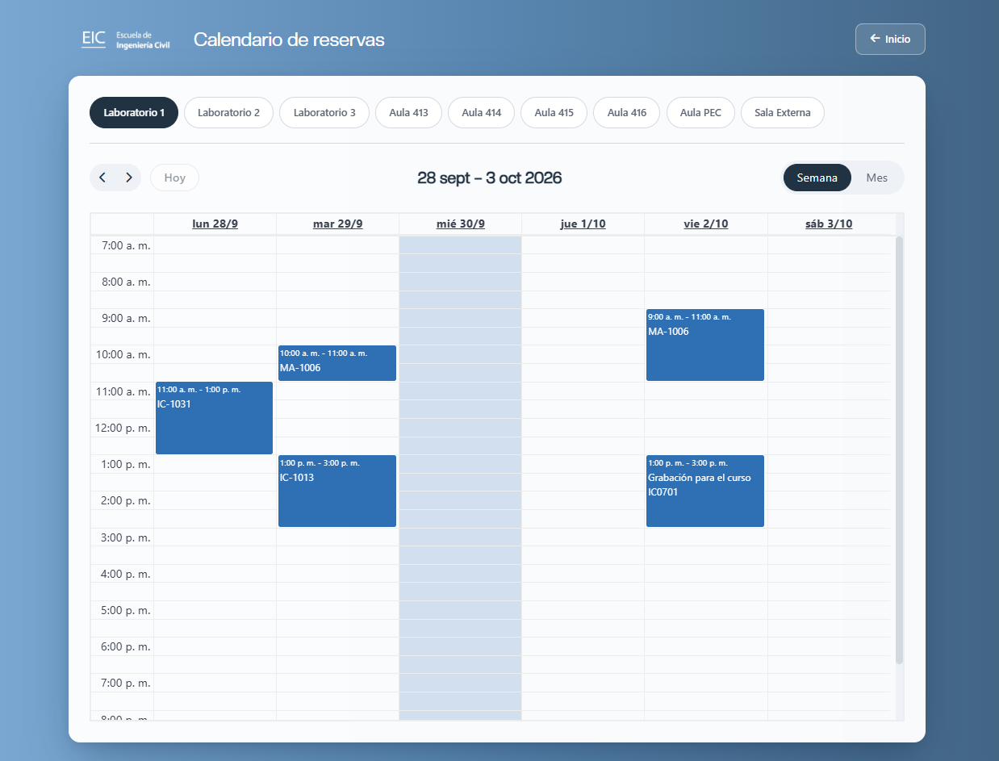
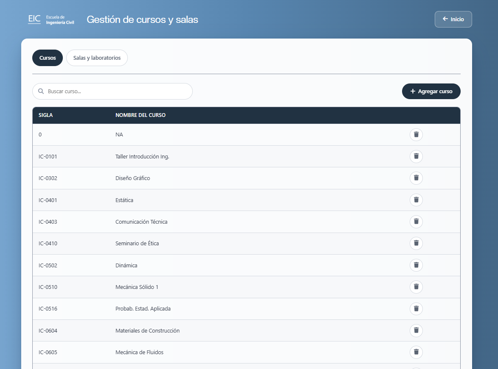

# Sistema de Reservas EIC

Sistema de registro de acceso a laboratorios y reserva de espacios de la **Escuela de Ingeniería Civil (EIC)**, Universidad de Costa Rica.

Automatiza y digitaliza dos procesos: la reserva de espacios (salas, aulas, laboratorios) por parte de docentes y personal administrativo, y el registro de entrada/retiro de cartuchera para el uso de laboratorios por parte de estudiantes y docentes.



## Módulos

El sistema tiene tres roles, cada uno con su propio inicio de sesión (vía Active Directory) y funcionalidades:

- **Estudiante** — registrar su ingreso a un laboratorio.
- **Docente** — registrar ingreso a un laboratorio, reservar espacios para impartir cursos, ver el calendario de reservas de toda la escuela.
- **Administrativo** — ver la bitácora de accesos de estudiantes/docentes, crear reservas (incluyendo reservas repetidas), ver el calendario con el detalle completo, y administrar el catálogo de cursos y espacios reservables.



Las reservas aprobadas de todos los espacios se ven en un calendario semanal/mensual compartido:



El catálogo de cursos y de salas/laboratorios es editable desde el panel de administrativo, y esos cambios se reflejan de inmediato en los formularios de docente:



## Stack técnico

PHP 8.3 · MariaDB 11 · nginx + PHP-FPM (Docker, sin Apache) · autenticación LDAP directa contra Active Directory (sin cuenta de servicio) · FullCalendar, Flatpickr, Alertify.js, jQuery.

## Cómo levantarlo

```bash
cp .env.example .env    # completar AD_SERVER y credenciales de BD
docker compose build web
docker compose up -d
```

La app queda disponible en `http://localhost:8083`.

## Documentación

Para arquitectura, modelo de datos, detalle de cada módulo y guía de despliegue en producción, ver **[MANUAL-TECNICO.md](MANUAL-TECNICO.md)**.

## Librerías externas

Alertify · Bootstrap · Flatpickr · Font Awesome · FullCalendar · jQuery · pdfmake · SheetJS

> El envío de correo (antes vía PHPMailer) está deshabilitado a propósito: el sistema no envía correos bajo ninguna circunstancia. Ver `shared/utils/send-mail.php`.

Algunas de las imágenes usadas en la interfaz (`calendario.png`, `llave.png`, `mas.png`, entre otras) se crearon a partir de íconos gratuitos y libres de regalías del banco de imágenes Pixabay; los íconos originales ya no están en el repositorio, solo las versiones creadas a partir de ellos.
